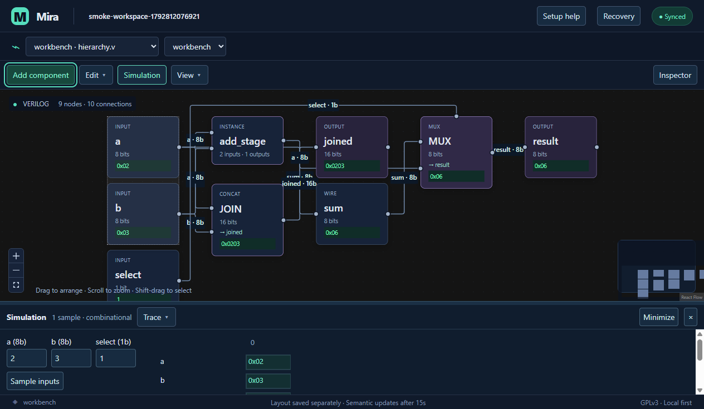

# Mira Graphical

Build, wire and explore HDL circuits in a Windows desktop workspace, with live source synchronization to VS Code.

**[Download for Windows x64](https://github.com/Lithium357/Mira-Graphical/releases/download/v0.8.0/Mira-Graphical-Setup-0.8.0-x64.exe)** · [Release notes and checksums](https://github.com/Lithium357/Mira-Graphical/releases/tag/v0.8.0) · [User guide](docs/user-guide.md)

## Start testing

1. Run **Mira-Graphical-Setup-0.8.0-x64.exe** and launch **Mira Graphical**.
2. Choose your HDL project folder. Open **Setup help → Show VS Code extension…** to locate the bundled companion.
3. In VS Code, run **Extensions: Install from VSIX…**, select that companion, and open the same project folder.
4. Open a `.v`, `.sv`, `.vhd` or `.vhdl` file and run **RTL Graph: Open Current Module**. The circuit appears after **15 seconds of inactivity**.

The app includes its runtime; Node, pnpm and a terminal are unnecessary for installation. **0.8.0 is an unsigned testing preview**. Windows may show an unknown-publisher/SmartScreen prompt. See [installation and checksum verification](docs/distribution.md).

## What you can do

- Construct and wire arithmetic, bitwise operations, muxes, constants, ports, buses and reusable modules.
- Edit supported Verilog, SystemVerilog and VHDL through the graph or live VS Code buffer. Source patches preserve surrounding text and support native editor Undo.
- Inspect named signals and widths, sample combinational inputs and view local waveforms.
- Resize or collapse the inspector and simulation dock, navigate with the keyboard, and recover unsaved source or graph drafts as reviewable copies.

**Current scope:** bounded, unsigned combinational circuits within the [supported syntax](docs/supported-syntax.md). Clocked logic, full HDL standards, synthesis and testbenches are outside this version. Unsupported source produces a diagnostic; the last valid graph stays visible. Review [real-project compatibility](docs/compatibility.md) before trying a larger design.

## Documentation

| Looking for…                                     | Start here                                                                |
| ------------------------------------------------ | ------------------------------------------------------------------------- |
| Circuit editing, wiring, simulation and recovery | [User guide](docs/user-guide.md)                                          |
| Installation, bundled companion and checksums    | [Windows distribution](docs/distribution.md)                              |
| Supported language constructs and limits         | [Syntax reference](docs/supported-syntax.md)                              |
| Build from source and run checks                 | [Development](docs/development.md)                                        |
| Design and synchronization behavior              | [Architecture](docs/architecture.md)                                      |
| Test evidence and remaining release work         | [Testing](docs/testing.md) · [Launch readiness](docs/launch-readiness.md) |
| Changes between versions                         | [Changelog](docs/changelog.md)                                            |

Found a problem? [Report a bug](https://github.com/Lithium357/Mira-Graphical/issues/new?template=bug_report.yml) with a small HDL example and the steps to reproduce it. See [contributing](CONTRIBUTING.md) for development and review guidance.

Licensed under [GPL-3.0-only](LICENSE). [Third-party licenses and notices](docs/licenses.md) accompany the packaged app.
